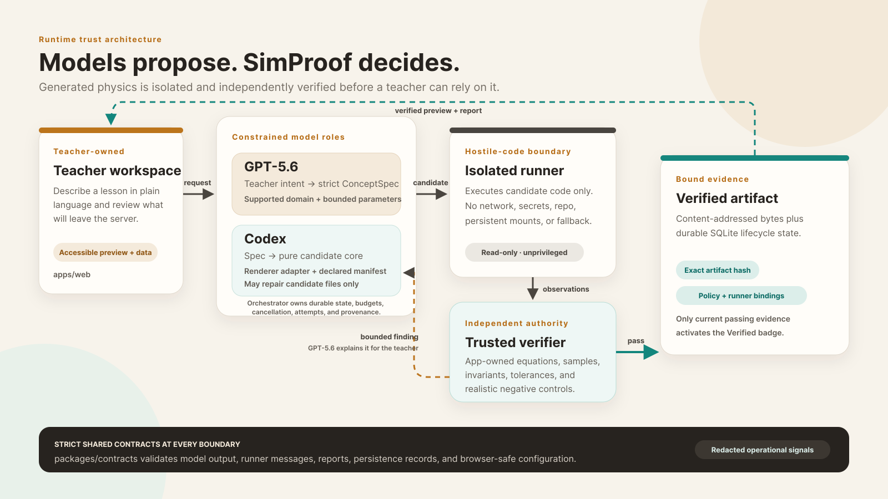

# SimProof

[](LICENSE)
[](https://github.com/sneg55/simproof/stargazers)


SimProof is a self-hosted tool for teachers. It generates an interactive STEM
simulation from a plain-language lesson, then releases it only after an
application-owned verifier checks the generated physics against a named, versioned
scientific policy. Models propose a simulation. The application decides whether it is
correct.

## What it is, and what it is not

This repository is the initial production scope: the React teacher experience, the Node
orchestrator, the provider adapters, the reviewed projectile and pendulum domain packs,
the isolated runner and its bounded launcher, SQLite plus content-addressed persistence,
local diagnostics, and the supported Docker Compose deployment. The original Python
proof is still here as independent evidence for the critical path.

The source tree alone does not imply a public release. A release is eligible only after
the repository, scientific, security, accessibility, build, deployment, recovery, and
release-provenance gates are green. See the [product contract](PRODUCT_SPEC.md) and the
[release and support policy](docs/operations/releases-and-support.md).

The supported product serves one teacher administrator in a single-tenant, self-hosted
deployment. Bundled projectile and pendulum examples work without model credentials.
Configured OpenAI and Codex credentials enable generation for those same reviewed
domains. "Verified" has a narrow meaning: one exact artifact passed one named policy
version within its declared assumptions, bounds, samples, and tolerances. It is not a
claim of universal correctness or pedagogical fit.

Out of scope: student accounts or records, multi-user collaboration, school SSO or OIDC,
hosted SaaS, runtime-loaded domain plugins, and production support for circuits or
graphing. Models cannot change trusted equations, inputs, controls, or tolerance policy
during repair.

## Architecture



```text
teacher browser
  -> authenticated web edge
  -> orchestrator and schema-constrained providers
  -> generated pure simulation core
  -> bounded launcher and isolated runner container
  -> trusted application verifier
  -> repair, preview, or publication with versioned evidence
```

The orchestrator owns generation, bounded repair, lifecycle, provenance, and
persistence, but it holds no domain equations. Generated cores run only in fresh,
network-disabled runner containers. Application-owned renderers consume verified data
and provide accessible SVG plus an equivalent visible data view.

## How GPT-5.6 and Codex are used at runtime

The two models have separate jobs, and neither one decides scientific truth.

GPT-5.6 turns a teacher's request into a strict `ConceptSpec` for one supported domain.
That specification chooses parameters and instructional intent. It cannot define
equations, tolerances, or a passing verdict, because those live in reviewed
application-owned domain packs. GPT-5.6 has one more job: when a candidate is rejected,
it writes a plain-language explanation of the failure. That explanation is commentary on
the verdict. It cannot change the result.

Codex receives the validated specification and writes only the candidate simulation
core, renderer adapter, manifest, and test adapter, inside a disposable workspace. The
orchestrator inventories those files, rejects anything outside the allowlist, and runs
the candidate core only in the isolated runner. If verification fails, Codex may repair
the candidate files. It never gets authority over the verifier, the reference inputs,
the negative controls, or the tolerance policy.

## How this repository was built

The shipped product keeps scientific truth outside the models. The repository was built
the same way: the design lived in specifications, and the models worked from them.

The work started with documents, not prompts. `PRODUCT_SPEC.md` fixed the product
contract, and `docs/decisions/` records the five ADRs for the decisions that define the
trust model. Implementation then followed one standing rule for every change: write the
failing tests first, implement against the contract, run an independent review pass,
resolve the actionable findings, run `pnpm check` and the Python proof, and commit to
`main`. Any change that touched `apps/web` also required a browser smoke test of the
changed behavior. Credentials and provider session material are intentionally not
committed.

## Shared schemas

Every process boundary is validated by a Zod schema in `packages/contracts`. The package
is the source of truth; the list below is a map into it.

- **`ConceptSpec`** (`concept.ts`) is the schema-constrained request GPT-5.6 produces. It
  is a discriminated union over the supported `domain` (projectile or pendulum) with a
  title, bounded `parameters` (each with a unit, a default, and a requested range), and
  a set of requested controls. A default must fall inside its range.
- **Artifact bundle** (`artifact.ts`) is the set of candidate files Codex declares, each
  bound by role (`core-source`, a `renderer-source` or `renderer-data`, `manifest`) and
  by content hash. The media type must agree with the role, and nothing outside the
  allowlist is stored.
- **Runner protocol** (`runner.ts`) is the request and response between the orchestrator
  and the isolated runner, pinned to `RUNNER_PROTOCOL_VERSION` with hard limits: 256 KiB
  per artifact, 16 MiB of output, and 10,000 samples.
- **Observations** (`observation.ts`, `domain-scene.ts`) are the normalized values the
  runner returns and the verifier checks. Application-owned renderers consume these, not
  the generated core.
- **`VerificationReport` and findings** (`report.ts`, `finding.ts`,
  `finding-explanation.ts`) carry the verdict (`verified`, `rejected`, or
  `inapplicable`), the individual checks, the findings with quantity, expected, actual,
  and tolerance, the tested scope, and the optional model explanation of a rejection.
- **Policy and evidence bindings** (`policy.ts`, `validity.ts`) name the versioned
  scientific authority and the content hashes that tie a report to one exact artifact,
  policy, domain pack, and runner. Change any of them and the evidence goes stale.
- **Persistence records** (`persistence.ts`, `generation.ts`, `lifecycle.ts`) are the
  durable, immutable rows for concepts, artifacts, generation runs, verification runs,
  findings, and publications.
- **Educator API** (`educator-library.ts`, `educator-generation.ts`,
  `educator-preview.ts`, `educator-report.ts`, `educator-comparison.ts`,
  `educator-runtime.ts`) defines the request and response types for the teacher-facing
  HTTP boundary.
- **Auth and privacy** (`auth.ts`, `privacy.ts`) hold the single-administrator session
  and CSRF contracts and the prompt-retention and telemetry posture.

## Local walkthrough for reviewers

For a local walkthrough without managing an administrator password, use the loopback-only
test override after the normal deployment preparation:

```sh
docker compose \
  --env-file .env \
  --env-file .simproof/deployment.generated.env \
  -f compose.yaml \
  -f compose.local-test.yaml \
  up -d
```

This profile is rejected for network or production origins. It keeps CSRF protection
active, stores no bypass session, and never puts provider credentials in the browser.
The bundled projectile and pendulum examples are the sample data and need no model
credentials.

Design and operations references:

- [System overview](docs/architecture/system-overview.md)
- [Trusted verification](docs/decisions/0001-trusted-verification.md)
- [Supported deployment](docs/decisions/0002-supported-deployment.md)
- [Storage and artifact lifecycle](docs/decisions/0003-storage-and-artifacts.md)
- [Privacy posture](docs/decisions/0004-privacy-posture.md)
- [Licensing](docs/decisions/0005-licensing.md)

## Prerequisites

- Linux with Docker Engine and Docker Compose v2 for the supported deployment
- Node.js `>=24.15 <25` with Corepack for repository work
- the exact pnpm version in `package.json`'s `packageManager` field
- Python 3 for the proof harness

Docker Desktop, rootless or remote daemons, alternate Docker sockets, Kubernetes, and
non-Linux production hosts are not supported release profiles. Development smoke results
on those platforms do not establish production compatibility.

## Repository setup

```sh
corepack enable
pnpm install --frozen-lockfile
pnpm check
```

`pnpm check` is the authoritative repository gate. It checks generated domain-pack
fingerprints, formatting, lint, typed boundaries, repository policies, the
non-browser unit, integration, security, diagnostic, and deployment suites, the Python
proof, and the production builds. Playwright end-to-end and accessibility checks are
separate release gates. Useful focused commands:

```sh
pnpm test
pnpm test:domain-packs
pnpm test:security
pnpm test:e2e
pnpm test:a11y
pnpm test:deployment
pnpm proof
pnpm build
```

The deployment test uses a test-only deterministic provider against disposable state.
That provider is not in production images and is never a production fallback.

## Supported production setup

Start from a clean checkout of an exact release. Copy `.env.example` to `.env`, fill the
three independent secrets, and leave the provider fields absent for seed-only operation:

```sh
cp .env.example .env
node scripts/prepare-deployment.mjs
node scripts/prepare-deployment.mjs --check
docker compose --env-file .env --env-file .simproof/deployment.generated.env config --quiet
docker compose --env-file .env --env-file .simproof/deployment.generated.env build
pnpm test:deployment
```

Then run the explicit first migration and readiness sequence from the
[deployment runbook](docs/operations/deployment.md). The default browser endpoint is
`http://127.0.0.1:8080`. Network exposure requires one exact HTTPS origin and a reviewed
TLS reverse proxy. The seed library and the administrator bootstrap work without provider
credentials. Do not use the test provider fixtures in an operator deployment.

Before operating real data, read:

- [Deployment configuration](docs/operations/configuration.md)
- [Backup and restore](docs/operations/backup-restore.md)
- [Upgrades and rollback](docs/operations/upgrades.md)
- [Observability and support diagnostics](docs/operations/observability.md)

## Security

Generated code is hostile input even when its output passes the scientific checks.
**Never run a generated artifact on the host, in the browser, or in the orchestrator.**
Do not weaken the runner's no-network, no-secret, no-host-mount, read-only,
resource-bounded profile, and do not expose the Docker socket outside the launcher.

Report vulnerabilities through the private path in [SECURITY.md](SECURITY.md), never a
public issue. General contribution guidance is in [CONTRIBUTING.md](CONTRIBUTING.md).

## Licensing

SimProof source code and repository documentation are licensed under
[Apache-2.0](LICENSE). Bundled educational examples are separately licensed under
[CC BY 4.0](LICENSE-CONTENT), with attribution and scope in [NOTICE](NOTICE).
User-generated artifacts are not relicensed by the repository. Exports keep their
recorded, configurable license metadata and provenance. That metadata is not proof of
ownership, copyrightability, or authority to grant a license.
